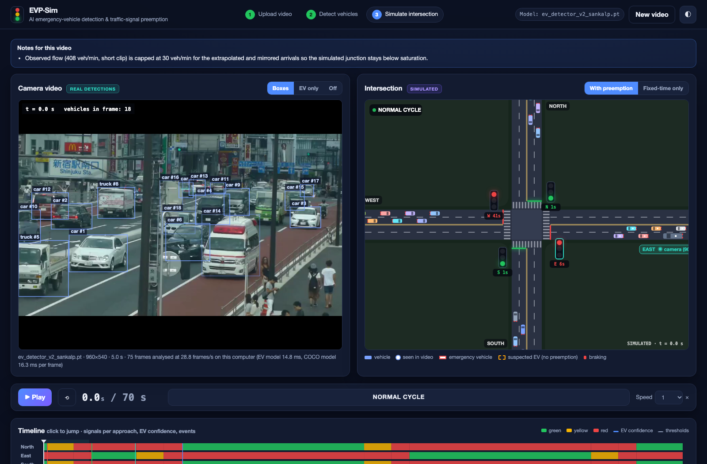
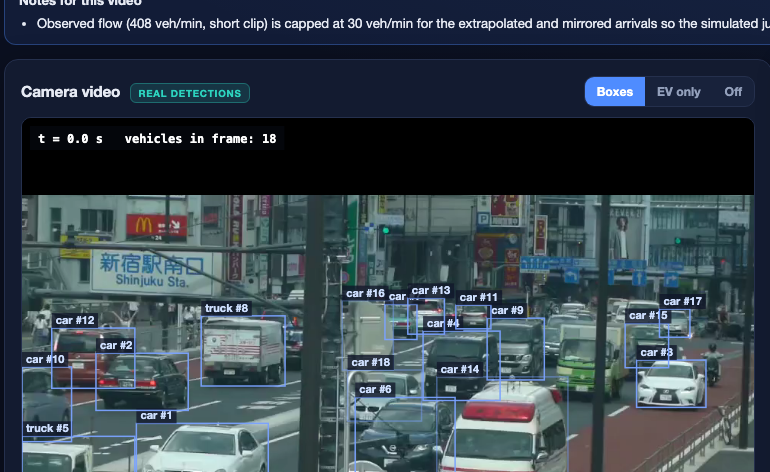
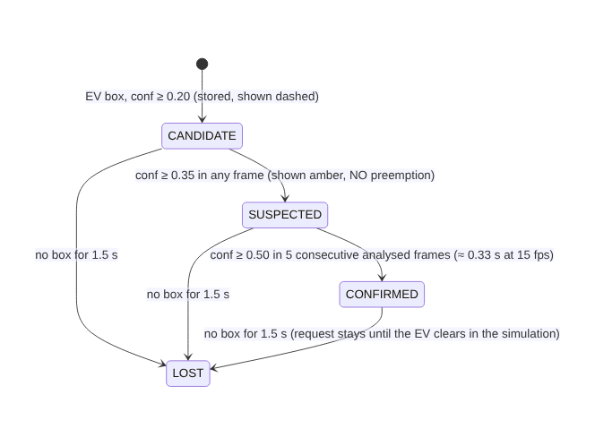
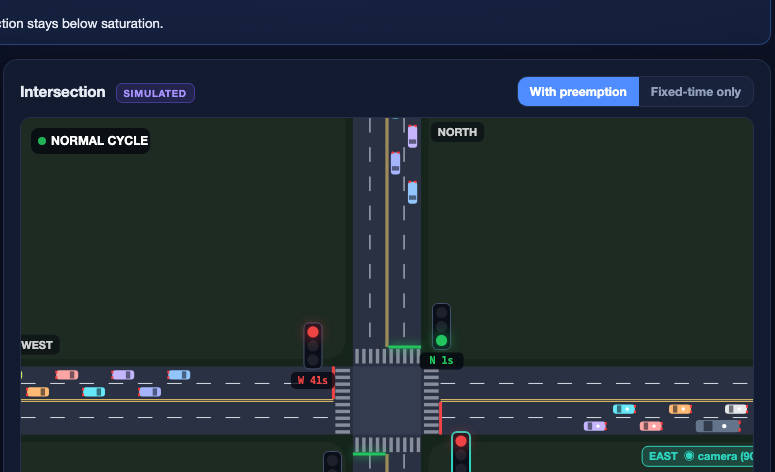
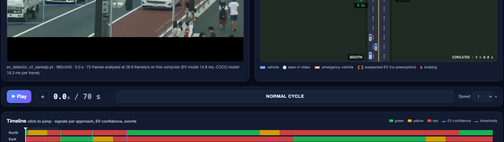
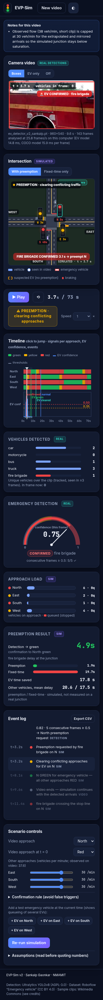
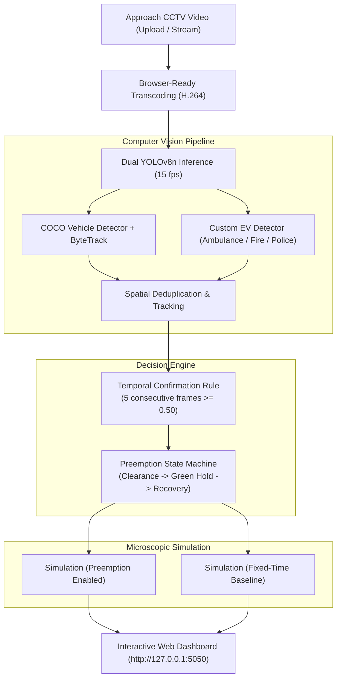
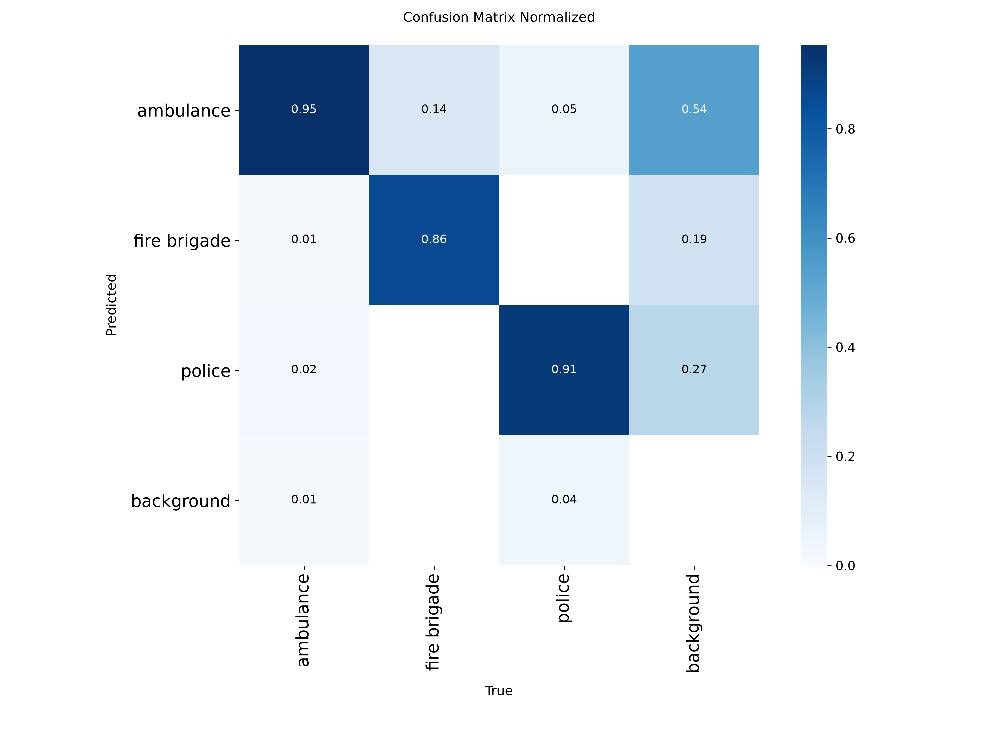

# 🚦 EVP·Sim: Vision-Based Emergency Vehicle Preemption & Traffic Simulation

<div align="center">

[](https://www.python.org/)
[](https://github.com/ultralytics/ultralytics)
[](https://pytorch.org/)
[](https://flask.palletsprojects.com/)
[](https://www.docker.com/)
[](https://render.com/)
[](LICENSE)

**An intelligent, camera-only traffic signal preemption system that detects emergency vehicles in real time, eliminates false alarms with a temporal confirmation rule, and dynamically clears intersections.**

**Maintained & Enhanced by [Sankalp Gaonkar](https://github.com/sankalpgaonkar)**

[🚀 Quick Start](#-quick-start) • [✨ Key Capabilities](#-key-capabilities) • [📸 Visual Walkthrough](#-visual-walkthrough-tokyo-intersection-scenario) • [🧠 Detection Models](#-detection-models) • [☁️ Deployment](#️-cloud-deployment-render--docker) • [🧪 Testing](#-automated-testing)

---


*Live Web Dashboard (Tokyo Intersection Scenario): Real-time video detection overlay with ambulance confirmation (left) synchronized with 4-way intersection simulation, preemption state machine, signal countdowns, and comparative performance metrics (right).*

</div>

---

> [!IMPORTANT]
> **Research & Demonstration Notice:** This is a research and proof-of-concept simulation system. It must not be connected to live traffic signals without independent safety certification, hardware fail-safes, and explicit authorization from relevant municipal road authorities.

---

## 🌟 Overview

Conventional emergency vehicle preemption requires dedicated hardware (optical infrared emitters, acoustic sensors, or in-vehicle GPS transponders) installed on every fleet vehicle and traffic cabinet. 

**EVP·Sim** eliminates specialized hardware by leveraging **standard intersection CCTV cameras**:
1. **Dual-Model Vision Engine:** Runs Ultralytics YOLOv8n with ByteTrack for ordinary traffic counting alongside custom fine-tuned emergency vehicle detectors (`ambulance`, `fire brigade`, `police`).
2. **Temporal Confirmation Rule:** Prevents transient false alarms (e.g. delivery vans, glare) from triggering disruptive green signals using a 5-frame persistence gate.
3. **Safety-Guaranteed Signal Controller:** Enforces mandatory clearance transitions (3s Yellow + 2s All-Red) before serving emergency traffic, with support for green extensions and multi-EV priority queues.
4. **Synchronized Microscopic Traffic Simulator:** Integrates the Intelligent Driver Model (IDM) and rescue-lane passing behaviors, running preemption and fixed-time control back-to-back on identical vehicle arrivals to measure exact travel-time savings.

---

## ✨ Key Capabilities

| Component | Technical Implementation |
|---|---|
| **Vision & Tracking** | Dual YOLOv8n pipeline (`15 fps` analysis): COCO vehicle detector with ByteTrack tracking + Custom EV detector with nested-box suppression. |
| **False-Alarm Mitigation** | Causal state machine: `CANDIDATE` (raw) $\rightarrow$ `SUSPECTED` (amber, conf $\ge 0.35$) $\rightarrow$ `CONFIRMED` (red, 5 consecutive frames at conf $\ge 0.50$). |
| **Fail-Safe Preemption** | Conflict-free state machine with green extension, 3s yellow clearance, 2s all-red clearance, emergency green hold, and recovery cycle. |
| **Microscopic Simulation** | 4-approach junction simulation with Intelligent Driver Model (IDM) car-following, left-hand traffic (India-ready), and rescue-lane yielding. |
| **Live Comparative Analytics** | Direct side-by-side comparison of Preemption vs. Fixed-Time: EV response time, delay saved, vehicle queue discharge, and cross-street penalty. |
| **Zero External Simulation Deps** | Self-contained Python/HTML5 engine—runs in any browser without requiring external SUMO or Unity installations. |

---

## 📸 Visual Walkthrough (Tokyo Intersection Scenario)

### 1. Ingestion & Dual-Model Detection
As video frames stream in from the intersection camera, ordinary vehicles are tracked with persistent ByteTrack IDs (green boxes), while the emergency vehicle is tracked and confirmed (red box, `ambulance 0.82`).

<div align="center">
  
  <p><em>Real-time detection overlay on Tokyo intersection: Ambulance identified with high confidence alongside surrounding traffic.</em></p>
</div>

---

### 2. Temporal Confirmation & Clearance Sequence
When an emergency vehicle is detected, the confidence persistence state machine verifies stability before changing the signal phase.

<div align="center">
  
  <p><em>State machine lifecycle: Raw detections enter as CANDIDATE, elevate to SUSPECTED (amber), and require 5 consecutive frames ≥ 0.50 to become CONFIRMED (red).</em></p>
</div>

---

### 3. Preemption Green & Rescue Lane Passage
Upon confirmation, conflicting traffic clears through a mandatory Yellow + All-Red interval, and the emergency approach turns **GREEN**. On the junction canvas, queued vehicles pull aside into a rescue lane to allow rapid passage.

<div align="center">
  
  <p><em>Synchronized 4-approach junction simulation: Emergency approach given priority green while cross-traffic safely halts.</em></p>
</div>

---

### 4. Side-by-Side Performance Comparison
Every run evaluates identical arrivals twice—once with preemption enabled, and once under standard fixed-time cycle control.

<div align="center">
  
  <p><em>Tokyo Ambulance Performance: Delay reduced from 21.93s (fixed-time) to 1.93s (preemption) with 0 stopped time, alongside timestamped event log.</em></p>
</div>

---

### 5. Mobile & Responsive Dashboard
The entire interface is built with vanilla HTML/CSS/JS without external CDN dependencies, running seamlessly across desktop and mobile devices.

<div align="center">
  
  <p><em>Responsive UI with dark/light themes and instant re-simulation controls.</em></p>
</div>

---

## 🏗️ System Architecture



---

## 🧠 Detection Models

The system includes multiple selectable detection models:

| Model Key | Weights File | Architecture | Description |
|---|---|---|---|
| **`v2` (Default)** | `project/models/ev_detector_v2_sankalp.pt` | YOLOv8n (3.14M params) | Retrained on clean duplicate-filtered split; lowest false-alarm rate on general photos (20/98). |
| **`v3`** | `project/models/ev_detector_v3_sankalp.pt` | YOLOv8n (3.14M params) | Trained with 442 additional open images (many Indian roads & "108" ambulances); higher recall on Indian clips. |
| **`v1`** | `project/models/yolo_emergency_detector.pt` | YOLOv8n | Original 2025 baseline model. |
| **`v2alt`** | `project/models/ev_detector_v2_alt.pt` | YOLO11n (2.61M params) | YOLO11n comparison architecture. |

### Normalized Confusion Matrix (v2 Clean Split)
Evaluated on the held-out validation set with zero data leakage:

<div align="center">
  
  <p><em>Diagonal recall rates: Ambulance 95%, Fire Brigade 86%, Police 91%. Background false positives motivate the 5-frame confirmation gate.</em></p>
</div>

---

## 🚀 Quick Start

### 1. Prerequisites
* **Python 3.10 – 3.12**
* macOS, Linux, or Windows
* At least 4 GB RAM recommended for local YOLO inference
* FFmpeg (handled automatically or via system package manager)

### 2. One-Click Run

#### macOS / Linux:
```bash
git clone https://github.com/sankalpgaonkar/Emergency_Vehicle_Preemption.git
cd Emergency_Vehicle_Preemption
./run_mac.sh
```

#### Windows:
```cmd
git clone https://github.com/sankalpgaonkar/Emergency_Vehicle_Preemption.git
cd Emergency_Vehicle_Preemption
run_windows.bat
```

*(The launcher scripts automatically create `.venv`, install dependencies from `demo_app/requirements.txt`, and start the Flask server).*

### 3. Open in Browser
Navigate to **`http://127.0.0.1:5050`**, pick a sample scenario (e.g. *Tokyo — ambulance at an intersection* or *Toronto — fire truck responding*), and click **Run**. Use **Spacebar** to play/pause.

Supported video formats include MP4, AVI, MOV, MKV, WEBM, M4V, MPG, MPEG, WMV, and OGV (up to 300 MB).

---

## ☁️ Cloud Deployment (Render / Docker)

The repository is pre-configured for instant zero-configuration deployment to **Render** or any Docker-compatible cloud host:

### Deploy to Render (Recommended)
1. Push this repository to your GitHub account.
2. Sign in to [Render](https://render.com) $\rightarrow$ Click **New +** $\rightarrow$ **Web Service**.
3. Connect your GitHub repository. Render will automatically detect the [Dockerfile](Dockerfile) and [render.yaml](render.yaml).
4. Select the **Free** instance tier and click **Deploy**.

The Dockerfile is optimized for lightweight CPU inference:
* Pre-installs `ffmpeg` and `libgl1`.
* Uses **CPU-only PyTorch**, reducing container size by 2+ GB and keeping RAM usage well under Render's 512 MB free tier ceiling.
* Exposes `/api/health` as the automated health-check endpoint.

### Other Docker Platforms
The container can run on Railway, Fly.io, Google Cloud Run, AWS ECS, or any standard VM:

```bash
docker build -t emergency-vehicle-preemption .
docker run --rm -p 5050:5050 -e PORT=5050 emergency-vehicle-preemption
```

### Note on Vercel
Vercel is designed for serverless static/Edge workloads with strict timeout and package size constraints. Because EVP·Sim performs CPU-intensive multi-model YOLO inference, FFmpeg transcoding, and background video jobs, the backend is best hosted as a containerized service (Render, Cloud Run, Railway). Vercel can be used to host a decoupled frontend that calls the Render API.

---

## 🧪 Automated Testing

The codebase includes 29 rigorous unit and integration tests verifying safety invariants (no conflicting greens, mandatory clearance yellow/all-red), confirmation rules, simulation mechanics, and API endpoints:

```bash
# Run test suite
python -m pytest -v demo_app/tests
```

```text
demo_app/tests/test_api.py .........          [ 31%]
demo_app/tests/test_confirm.py .....          [ 48%]
demo_app/tests/test_controller.py ........    [ 75%]
demo_app/tests/test_models.py ..              [ 82%]
demo_app/tests/test_simulation.py .....       [100%]

========================= 29 passed in 4.12s =========================
```

---

## 📂 Repository Structure

```text
Emergency_Vehicle_Preemption/
├── demo_app/                     # Interactive EVP web application
│   ├── app.py                    # Flask server & REST API
│   ├── core/                     # Core business logic
│   │   ├── config.py             # System parameters & model registries
│   │   ├── detector.py           # Dual YOLOv8n inference & ByteTrack wrapper
│   │   ├── ev_confirm.py         # Multi-frame temporal confirmation logic
│   │   ├── signal_controller.py  # Safety-enforced preemption state machine
│   │   ├── simulation.py         # 4-approach microscopic IDM traffic simulator
│   │   ├── video_io.py           # FFmpeg transcoding & probe helpers
│   │   └── pipeline.py           # End-to-end background job orchestration
│   ├── samples/                  # CC-licensed real-world emergency vehicle clips
│   ├── static/                   # Pure HTML5/CSS3/vanilla JS dashboard
│   ├── tests/                    # 29 automated safety & logic tests
│   └── weights/                  # Pre-downloaded YOLOv8n COCO weights
├── project/
│   ├── models/                   # Trained EV detector weights (v1, v2, v3, v2alt)
│   └── datasets/                 # Roboflow emergency vehicle dataset
├── training/                     # Dataset audit, cleaning & training scripts
│   ├── dataset_audit.py          # Near-duplicate & source leakage analysis
│   ├── make_clean_split.py       # Difference-hash & union-find dataset splitter
│   ├── train_ev_detector.py      # Reproducible YOLOv8 training script
│   └── runs/                     # Training curves, confusion matrices & metrics
├── docs/                         # Research paper, methodology PDF, diagrams & screenshots
├── Dockerfile                    # Container definition for cloud deployment
├── render.yaml                   # Render Blueprint infrastructure-as-code
└── run_mac.sh / run_windows.bat  # Instant launcher scripts
```

---

## 📜 Research & Documentation

Comprehensive research and engineering documentation is provided in the `docs/` folder:
* **[docs/METHODOLOGY.md](docs/METHODOLOGY.md) / [docs/METHODOLOGY.pdf](docs/METHODOLOGY.pdf):** Full paper write-up detailing dataset audit, mathematical formulation, measured detector latency, and simulated sweep results.
* **[docs/PROJECT_REVIEW.md](docs/PROJECT_REVIEW.md):** Deep-dive review of v1 vs v2 architectural enhancements and bug fixes.
* **[docs/ARCHITECTURE.md](docs/ARCHITECTURE.md):** System architecture specifications and design rationale.
* **[QUICK_START.md](QUICK_START.md):** Step-by-step developer setup and troubleshooting.

---

## 📄 License & Attribution

* Code is licensed under the [MIT License](LICENSE) &copy; 2026 Sankalp Gaonkar.
* Model architectures and inference depend on [Ultralytics YOLOv8](https://github.com/ultralytics/ultralytics) (AGPL-3.0).
* Training data originated from Roboflow Universe ("Emergency vehicle" v1, CC BY 4.0) with additional open licenses documented in [`docs/data_credits/`](docs/data_credits/).
* Video samples are from Wikimedia Commons under Creative Commons licenses (see [`demo_app/samples/CREDITS.md`](demo_app/samples/CREDITS.md)).
