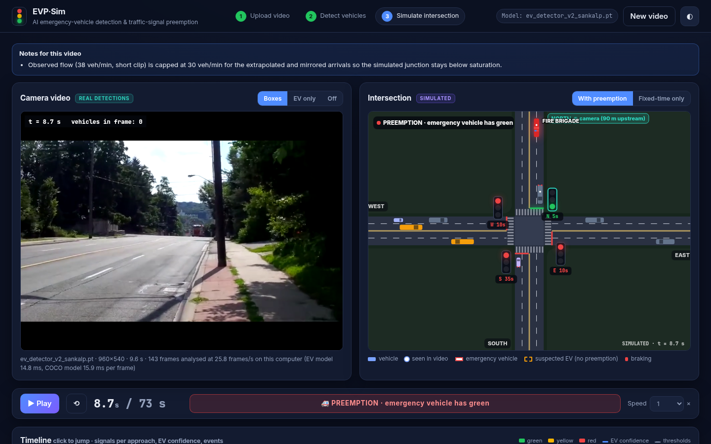

<!-- Copyright (c) 2026 Sankalp Gaonkar -->
# EVP·Sim v2 — Emergency-Vehicle Detection & Traffic-Signal Preemption Demo

Upload a traffic video. The trained YOLOv8 model finds every vehicle and every emergency vehicle in it. The same
vehicles then drive through a four-way intersection simulation, and the signal for the emergency vehicle's
approach turns green (after a safe yellow + all-red for the others) the moment the detection is **confirmed**.
Every signal change is tied to the second of video that caused it.



* **Left:** the video with detection boxes (ordinary vehicles in blue; emergency vehicles amber = suspected, red = confirmed).
* **Right:** the simulated junction: 4 approaches, 2 lanes each, left-hand traffic, signals with countdowns.
* **Below:** timeline (signal state of N/E/S/W, EV confidence with thresholds, events), vehicle counts, EV confidence
  gauge, approach load, preemption result (with vs without preemption), event log, scenario controls.

The original project files are untouched. Everything new lives in `demo_app/`, `training/` and `docs/`
(see `NEW_COMPONENTS.md`).

---

## 1. Setup on macOS (recommended, Apple Silicon or Intel)

You need Python 3.10–3.12 (check with `python3 --version`; install from python.org or `brew install python@3.11`).

```bash
cd Emergency_Vehicle_Preemption            # the unzipped project folder
python3 -m venv .venv
source .venv/bin/activate
pip install --upgrade pip
pip install -r demo_app/requirements.txt   # ultralytics, flask, imageio-ffmpeg, ...  (~1–2 GB with PyTorch)
python demo_app/app.py
```

Open **http://127.0.0.1:5050** in Chrome, Safari or Edge.

* No separate ffmpeg install is needed (`imageio-ffmpeg` brings one). If you already have Homebrew's ffmpeg, it is used.
* **CPU is the default** and is fast enough (on our 16-core test machine each frame took ~15 ms per model; a laptop will be
  slower, which only makes the analysis step take longer; playback is unaffected).
  On Apple Silicon you can try the GPU: `EVP_DEVICE=mps python demo_app/app.py`. If tracking errors appear, go back to CPU.
* macOS may ask to allow incoming connections for Python; the server only listens on 127.0.0.1, so "Deny" is fine.

## 2. Setup on Windows 10/11

```powershell
cd Emergency_Vehicle_Preemption
py -3.11 -m venv .venv
.venv\Scripts\activate
python -m pip install --upgrade pip
pip install -r demo_app\requirements.txt
python demo_app\app.py
```

Tip: to avoid a ~2 GB GPU download when you have no NVIDIA GPU, first run
`pip install torch torchvision --index-url https://download.pytorch.org/whl/cpu`.

Open http://127.0.0.1:5050. If PowerShell blocks `activate`, run
`Set-ExecutionPolicy -Scope CurrentUser RemoteSigned` once. With an NVIDIA GPU and CUDA PyTorch installed you can
set `set EVP_DEVICE=0` before starting.

## 3. Setup on Linux (Ubuntu/Debian)

```bash
sudo apt install python3-venv          # if needed
python3 -m venv .venv && source .venv/bin/activate
pip install torch torchvision --index-url https://download.pytorch.org/whl/cpu   # optional: CPU-only PyTorch, much smaller
pip install -r demo_app/requirements.txt
python demo_app/app.py --host 0.0.0.0 --port 5050    # --host 0.0.0.0 only if other devices must reach it
```

## 4. Demo script for the faculty presentation (≈ 3 minutes)

1. Open the app. Point at the three steps in the header: **Upload → Detect → Simulate**.
2. Click **Run** on *Toronto — fire truck responding*. While it analyses, the live preview shows the boxes being found.
3. When the dashboard opens, press **Play** (or Space). The North signal (the camera's approach) is red, East/West green.
4. At **t ≈ 3.1 s** the fire truck's box turns from amber (SUSPECTED) to red (**CONFIRMED**, 5 consecutive frames ≥ 0.50).
   The timeline, event log and the red pill on the junction say "confirmed → preempting North".
   East/West go **yellow → all-red → North green** (≈ 4.9 s, the safe clearance).
5. The simulated fire truck passes the queue (vehicles pull over) and crosses. Then **recovery**: North yellow,
   all-red, and the normal cycle resumes with East/West.
6. Click **Fixed-time only**: same arrivals, no preemption; the fire truck waits at the red light until about 26 s.
   The *Preemption result* card compares both (simulated).
7. Show the safety rule: run *Edinburgh junction*. Around 8.6–9.7 s the ambulance's box stays **amber**: its confidence
   flickers around 0.5 and never stays ≥ 0.50 for 5 frames in a row, so no preemption is triggered. Open
   *Confirmation rule*, set 3 frames and press **Re-run simulation**: now it is confirmed at 9.6 s. (With model v1 it is
   confirmed at 8.6 s with the default rule.) This is the trade-off between false preemptions and missed EVs.
8. Optional: **+ EV on East** and **Re-run simulation** shows two EVs on conflicting approaches served one after the other.

A recorded version of steps 1–6 is in `docs/demo/EVP_v2_demo.mp4`.

Keyboard: **Space** play/pause, **← / →** jump 1 s. Click anywhere on the timeline or an event-log row to jump there.
The theme button (◐) switches dark/light (light reads better on some projectors).

## 5. Using your own video

* Formats: MP4, AVI, MOV, MKV, WEBM, M4V, MPG, WMV, OGV, up to 300 MB; the first 180 s are analysed.
* Before uploading, choose which approach the camera watches (North by default) and whether that approach starts on red
  or green. A single camera normally shows one approach. All vehicles it sees are placed on that approach, and the
  other three approaches get the same flow unless you change the sliders.
* Unsupported, empty or corrupted files are rejected with a message. A video with no vehicles still runs (the junction then
  only has slider traffic).

## 6. Commands for the research paper

```bash
python demo_app/evaluate.py                    # all bundled samples with the default model → demo_app/results/
python demo_app/evaluate.py --model v1 --model v2 --model v3
python training/make_clean_split.py project/datasets/emergency_vehicles datasets_clean 20
python training/train_ev_detector.py --data datasets_clean/data.yaml --epochs 100
python training/dataset_audit.py project/datasets/emergency_vehicles datasets_clean   # source families + split similarity
python training/eval_detectors.py --models <model.pt> ... --clean datasets_clean/data.yaml --external external_test
python -m pytest -q demo_app/tests             # 29 automated tests
```

## 7. Which detector is used

| Key in the app | File | What it is |
|---|---|---|
| `v2` (default) | `project/models/ev_detector_v2_sankalp.pt` | YOLOv8n retrained on all 1,065 dataset images (3 Nov 2026). The default. |
| `v2alt` | `project/models/ev_detector_v2_alt.pt` | YOLO11n trained on the near-duplicate-filtered split (3 Nov 2026), kept for comparison. |
| `v1` | `project/models/yolo_emergency_detector.pt` | The original project detector (2025 v1 training run in `runs/detect/train/`). |
| `v3` | `project/models/ev_detector_v3_sankalp.pt` | YOLOv8n trained on the 1,065 images + 442 new openly licensed images, many Indian (3 Nov 2026). Selectable, not the default (see §7.1). |

Pick the model in the upload card. Ordinary vehicles are counted with Ultralytics' COCO-pretrained `yolov8n.pt`
(`demo_app/weights/`), because the EV model only knows the three emergency classes. How the models compare is in
`docs/METHODOLOGY.md` §9.1.

### 7.1 v3: + Indian images (selectable)

In the dropdown it is called **"v3 · + Indian images (2026)"**. It is the same YOLOv8n with the same training
settings as v2, trained on the original 1,065 images plus 442 new openly licensed photos (197 of the 521 new images are
Indian: "108" ambulances, state fire engines, police vehicles, and look-alikes such as white vans and buses). Every box of
the new images was checked by eye. All numbers below are MEASURED at confidence 0.5.

**A. 152 unseen Wikimedia photos** (the same fair test as before)

| Model | Ambulance found | Fire engine found | Any EV found (EV photos) | False alarms (98 non-EV photos) | Wrong class only |
|---|---|---|---|---|---|
| v1 (original) | 27/44 | 7/10 | 43/54 | 30/98 | 9/54 |
| v2 (default) | 29/44 | 6/10 | 41/54 | 20/98 | 6/54 |
| v3 (+ Indian images) | 27/44 | 8/10 | 42/54 | 26/98 | 7/54 |

**B. New Indian test set** (79 photos kept out of training, split by photographer)

| Model | Box mAP50 | Box mAP50-95 | Ambulance found | Fire found | Police found | False alarms (38 negatives) | Wrong class only |
|---|---|---|---|---|---|---|---|
| v1 | 0.440 | 0.262 | 7/13 | 10/13 | 4/15 | 16/38 | 4/41 |
| v2 | 0.507 | 0.412 | 7/13 | 9/13 | 6/15 | 16/38 | 6/41 |
| v3 | 0.684 | 0.436 | 7/13 | 11/13 | 11/15 | 11/38 | 3/41 |

**C. The 5 real clips** (`demo_app/evaluate.py`, confirmation = 5 frames in a row ≥ 0.50)

| Clip | v1 | v2 | v3 |
|---|---|---|---|
| Edinburgh ambulance | confirmed 8.55 s (ambulance); extra police track | not confirmed (suspected, max 0.856); extra police track | confirmed 9.02 s (ambulance) |
| Busy road, night (ambulance) | confirmed 0.28 s | confirmed 0.28 s | confirmed 0.28 s |
| NYC ambulance (night) | not confirmed | not confirmed | not confirmed (suspected, max 0.684) |
| Tokyo ambulance | confirmed 0.27 s; extra police track | confirmed 0.40 s | confirmed 0.27 s |
| Toronto fire truck | confirmed 2.87 s as **ambulance** (wrong class) | confirmed 3.14 s (fire brigade) | confirmed 1.74 s (fire brigade) |
| Correct-class confirmations | 3 of 5 | 3 of 5 | 4 of 5 |

**When to use which.** v3 is better on Indian roads and on the clips (more Indian police and fire vehicles found,
fewer false alarms on the Indian set, 4 of 5 clips confirmed with the right class). On the 152 general photos it is
mixed: 2 more fire engines but 2 fewer ambulances and more false alarms than v2 (26/98 vs 20/98). That is why v2 stays
the default. Use v3 when you demo Indian footage.

**Caveats.** The test sets are small (13–15 photos per class on the Indian set, 10 fire engines on the external set),
so one or two photos move a result a lot, and every 95% interval on the external set overlaps. The Indian set is not
perfectly neutral: its boxes started from v2's pre-labels (a slight advantage for v2 in box mAP), and some negatives
were picked *because* v2 raised a false alarm on them (harder for v2). Call v3 "promising", not proven.

**Data credit.** The new images come from Wikimedia Commons, Flickr (CC BY, CC BY-SA, CC0, public domain only) and
CC-licensed Commons videos. Each image's source, author and licence is in `docs/data_credits/EV_Indian_Dataset_v1_manifest.csv`.
Raw results: `docs/results/v3/`. Full write-up: `docs/METHODOLOGY.md` §4.4 and §9.5.

## 8. Troubleshooting

| Problem | Fix |
|---|---|
| `ModuleNotFoundError: ultralytics` | The virtual environment is not active: run `source .venv/bin/activate` (macOS/Linux) or `.venv\Scripts\activate` (Windows). |
| "ffmpeg is not available" | `pip install imageio-ffmpeg` |
| Port 5050 busy | `python demo_app/app.py --port 8000` |
| Analysis very slow | Close other heavy apps; analysis speed is shown in the processing screen. Shorter clips (10–30 s) demo best. |
| Video plays but no boxes | Check the overlay switch (Boxes / EV only / Off) above the video. |

## 9. Licences in one paragraph

Your own code is MIT (see `LICENSE`). The app depends on **Ultralytics YOLOv8 (AGPL-3.0)**: fine for coursework and an
open GitHub repository. If you ever distribute or host the app for others, the combined program's source must be
available under AGPL-3.0 (or buy an Ultralytics Enterprise licence). The training data is the Roboflow
"Emergency vehicle" dataset (CC BY 4.0, credit it); v3 also uses EV_Indian_Dataset_v1, whose images keep their own
CC / public-domain licences (one row per image in `docs/data_credits/EV_Indian_Dataset_v1_manifest.csv`). The sample clips are from Wikimedia Commons (credits in
`demo_app/samples/CREDITS.md`). Details in `docs/PROJECT_REVIEW.md` §6.
