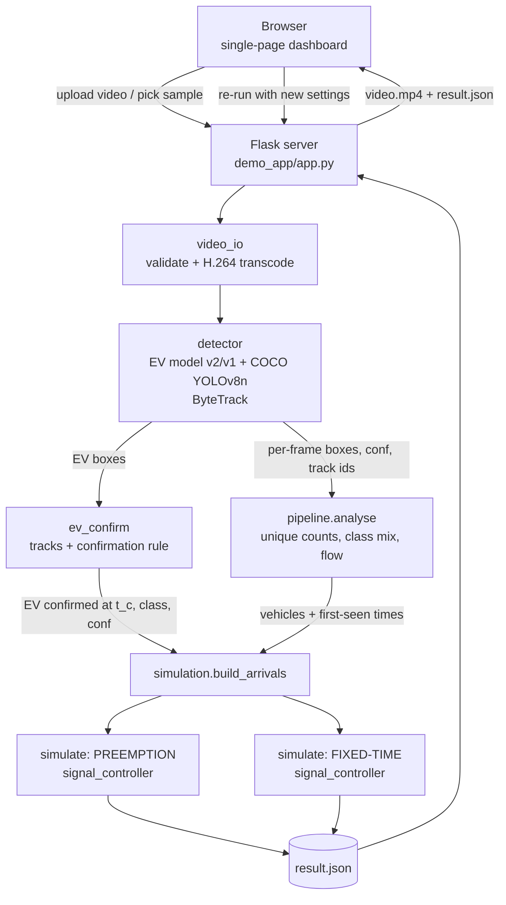
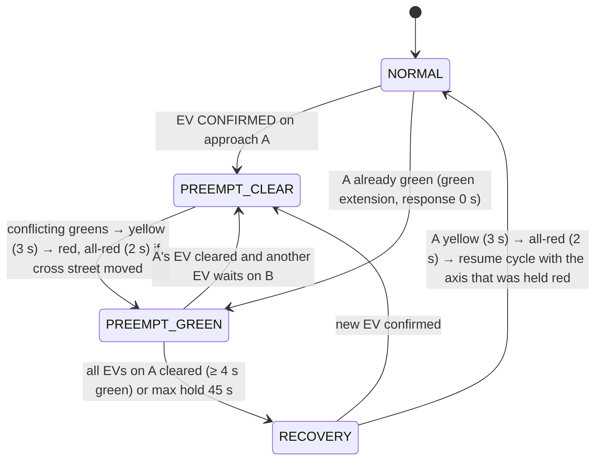
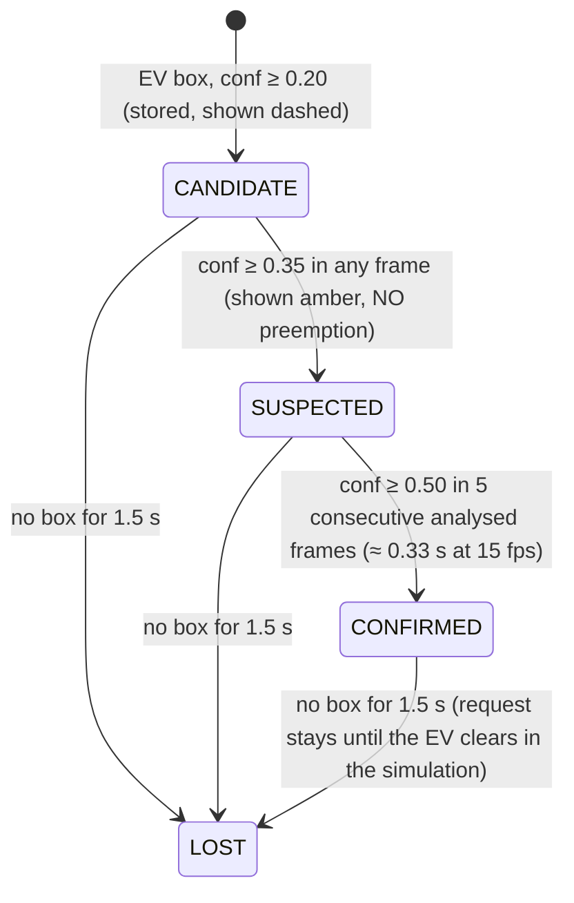

<!-- Copyright (c) 2026 Sankalp Gaonkar -->
# EVP·Sim v2 — System architecture

## 1. Overview



Image version for slides and the report: `figures/architecture.png`.

ASCII version:

```
 video file ──► validate ─► transcode (H.264) ─► for each analysed frame (15/s):
                                                   ├─ COCO YOLOv8n + ByteTrack ─► ordinary vehicles (id, class, box)
                                                   └─ EV YOLOv8n (v2|v1)        ─► EV boxes (class, conf)
                                                                 │
                         EV tracking + confirmation rule ◄───────┘
                                 │ (CONFIRMED at t_c)
   detected vehicles (first-seen time, class) ──► arrivals on the chosen approach (+ density for others)
                                 │
                 ┌───────────────┴────────────────┐
          simulate with PREEMPTION        simulate FIXED-TIME (same arrivals)
                 └───────────────┬────────────────┘
                           result.json ──► dashboard (video clock drives everything)
```

## 2. Time base and synchronisation

* The browser receives the **same H.264 file the detector analysed**, so a detection at video time *t* is drawn on the
  frame shown at *t*.
* The simulation runs on the server with the **video time as simulation time** (step 0.1 s). A confirmation at
  *t_c* becomes a preemption request at *t_c* in the simulation.
* In the browser one master clock drives every panel: while the video plays, `video.currentTime` is the clock; after
  the video ends, the clock keeps running at the chosen speed so viewers can watch the EV pass and the signals recover.
  Scrubbing the timeline or clicking an event seeks the video and the simulation together.

## 3. Components

| Module | Responsibility | Key outputs |
|---|---|---|
| `video_io.py` | open/probe with OpenCV, reject unreadable files, transcode with ffmpeg | `video.mp4`, fps, size, duration |
| `detector.py` | two YOLOv8n models per analysed frame; latency per call | `veh=[x1,y1,x2,y2,id,cls,conf]`, `ev=[x1,y1,x2,y2,conf,cls]` |
| `ev_confirm.py` | nested-box suppression, frame-to-frame association (IoU / containment / centre distance), streak counting, SUSPECTED/CONFIRMED/LOST | EV tracks with `first_t`, `suspected_t`, `confirmed_t`, class at confirmation |
| `pipeline.analyse` | unique vehicle counts (tracks seen ≥ 3 frames), link COCO tracks to EV tracks (no double count), observed flow | counts, class mix, per-frame series |
| `signal_controller.py` | fixed-time cycle, preemption state machine, request queue | signal history, events, response times |
| `simulation.py` | vehicles, lanes, IDM car-following, stop-line logic, rescue lane, metrics | trajectories (10 Hz), queues (2 Hz), EV delay, other-traffic delay |
| `app.py` | REST API, jobs in background threads (one analysis at a time), persistence of finished jobs | JSON + MP4 + CSV |
| `static/` | rendering only, no decisions: canvas overlay, intersection, timeline, gauge, log | — |

## 4. Preemption state machine



Image: `figures/preemption_state_machine.png`.

Invariants checked by `tests/test_controller.py`: crossing approaches are never green/yellow together; no approach goes
from green to red without yellow; the EV approach gets exclusive green; requests are served by priority
(ambulance = fire brigade < police), then by confirmation time.

## 5. Detection confirmation



Image: `figures/confirmation_states.png`.

A frame below 0.50 or a missed frame resets the streak. All three values can be changed in the dashboard and the
confirmation is recomputed from the stored detections (no re-detection needed).

## 6. Mapping a single camera to a four-way junction (assumption)

One camera normally shows one approach. The presenter chooses which approach it is (default North).

* Vehicles **seen in the first analysed frame** start on that approach, 30 m upstream of the stop line and further back.
* Vehicles **appearing later** enter the approach at the time they first appear.
* The confirmed EV enters at the time it is first seen. Its request is made at its confirmation time.
* **Other approaches** get Poisson arrivals at the rate observed on the video (capped at 30 veh/min), or at the
  rate set with the sliders (fixed random seed).
* After the video ends, the video approach continues at the observed rate ("extrapolated").
* The camera is assumed to be 90 m upstream of the stop line (shown on the canvas).

These are modelling choices, stated in the UI ("Assumptions") and in the methodology.

## 7. API

| Method | Path | Purpose |
|---|---|---|
| GET | `/api/health` | models present, ffmpeg found |
| GET | `/api/config` | all default parameters |
| GET | `/api/samples` | bundled clips with credits |
| POST | `/api/upload` (multipart `video`, `approach`, `initial_state`, `model`) | start a job |
| POST | `/api/samples/<file>/run` | start a job on a sample |
| GET | `/api/jobs/<id>` | status, progress, live stats |
| GET | `/api/jobs/<id>/preview.jpg` | latest annotated frame while processing |
| GET | `/api/jobs/<id>/video` | analysed H.264 video (range requests) |
| GET | `/api/jobs/<id>/result` | everything measured and simulated |
| POST | `/api/jobs/<id>/simulate` | re-run confirmation + simulations with new settings / test EVs |
| GET | `/api/jobs/<id>/report.csv` | export (measured vs SIMULATED rows labelled) |

## 8. Error handling

| Situation | Behaviour |
|---|---|
| Wrong extension | HTTP 415 with the list of formats (checked in the browser too) |
| Empty / tiny file | HTTP 422 |
| File > 300 MB | HTTP 413 |
| Corrupted / undecodable | job ends with "could not be decoded / may be corrupted"; server keeps running |
| Video longer than 180 s | first 180 s analysed, note shown |
| No vehicles / no EV | dashboard opens with a note; no preemption |
| Uncertain EV | shown as SUSPECTED (amber) in video and as a dashed vehicle in the simulation; no preemption |
| Several EVs | each confirmed track is a request; queue by priority then time; conflicting approaches served one after another |
| EV never clears | preemption released after 45 s (max hold), logged |
| Unexpected exception | job status "error" with the exception text |
