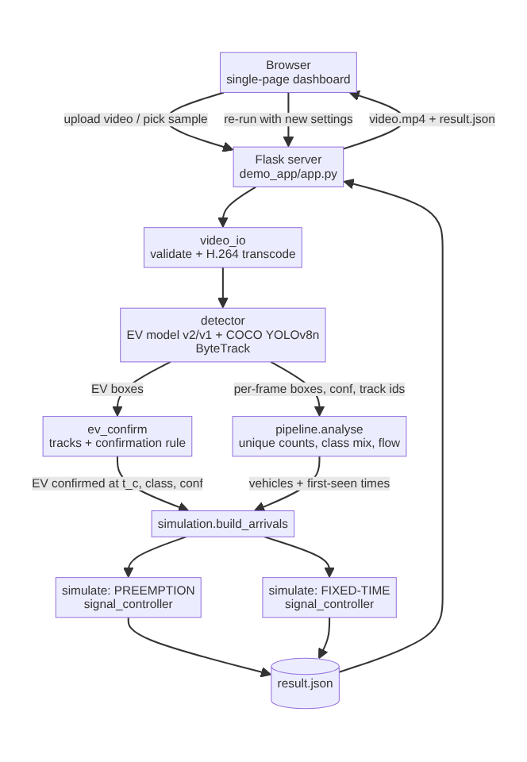
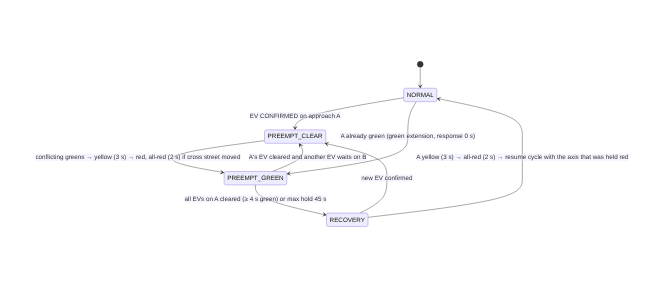

<!-- Copyright (c) 2026 Sankalp Gaonkar -->
# Methodology — Vision-Based Emergency-Vehicle Detection and Traffic-Signal Preemption (v2)

*Sankalp Gaonkar · document version 3 Nov 2026 · for the NMAMIT minor-project report and research paper*

Every number in this document is labelled:

* **MEASURED**: produced by running the software on real data (dataset images, real video clips) on the stated machine.
* **SIMULATED**: produced by the intersection simulation in `demo_app/core/simulation.py` from measured detections plus
  stated assumptions. These are model outputs, **not** field measurements, and must be reported as such in the paper.
* **ASSUMED**: a parameter chosen by us (listed in §7 with its source or reason).

The two kinds of result are reported in separate sections (§9 measured, §10 simulated) and must not be mixed in a claim.

## 1. Problem and contribution

Emergency vehicles (EVs) lose time at signalised junctions when their approach is red and the queue in front of
them cannot clear. Signal preemption gives the EV's approach a green early enough for the queue to discharge and the EV
to pass [1]–[6], [8]. Commercial preemption uses dedicated emitters (infrared, GPS, radio) [8]. This project studies
a **camera-only** trigger: an object detector recognises the EV in an approach camera's video, a confirmation rule filters
single-frame false detections, and a preemption controller performs a safe transition to an exclusive EV green, then
returns to the normal cycle.

Contribution of v2 over the original codebase and detector (v1, 2025):

1. An audit of the training data (near-duplicates, source diversity), a near-duplicate-filtered re-split, two retrained
   detectors (YOLOv8n and YOLO11n) and an independent external test set for a fair comparison with v1.
2. A temporal confirmation rule with separate SUSPECTED / CONFIRMED states, evaluated on real clips.
3. A preemption state machine with yellow and all-red clearance, exclusive EV green, multi-EV queueing, maximum hold and
   recovery, with automated safety tests.
4. A video-synchronised four-approach simulation that compares preemption with fixed-time control on identical arrivals.
5. An interactive demo application that shows all of the above on one clock.

## 2. System overview

Video → frame sampling (15 frames/s analysed) → two YOLOv8n detectors [14], [15] (EV detector + COCO vehicle detector
with ByteTrack [16]) → EV tracks + confirmation → preemption request at the confirmation time → simulation of the junction
with preemption and with fixed-time control → dashboard. Details and diagrams: `docs/ARCHITECTURE.md`.



*Figure 1. System architecture.*

## 3. Data

### 3.1 Training data (MEASURED properties)

Roboflow Universe "Emergency vehicle" v1 by user jd-s39ap [S2], **CC BY 4.0**: 1,065 images, three classes
(ambulance, fire brigade, police), YOLO box labels. Original split 745 train / 213 valid / 107 test.

**Near-duplicates.** Many images are consecutive frames of the same scene. Every image was reduced to a 256-bit
difference hash (16×16 dHash). Two images are near-duplicates if their hashes differ in ≤ 20 bits (≈ 8 %). In the
original split, **48 of 107 test images and 115 of 213 validation images have a near-duplicate in train**.

**Source diversity.** File names show that **94 % of the images come from three video sources** (490, 280 and 230
images). Two of them contain one class each (police only; ambulance only). Fire brigade has 16 images in total.
(`training/dataset_audit.py`, output in `docs/results/dataset_audit.json`.)

**Near-duplicate-filtered split.** Near-duplicates are joined into groups with union-find (574 groups). Whole groups
are assigned to train/val/test (seed 42): **745 / 160 / 160 images, no test image within 20 bits of a training
image** (`training/make_clean_split.py`). This removes repeated frames but not repeated scenes: 34 of the 160 test images
are within 30 bits of a training image and show the same scene moments later (median nearest distance 61 bits, against
23 bits in the original split). Stricter thresholds were tried and still leave same-scene pairs. The in-dataset test score
is therefore a **within-source** score. Generalisation is measured on the external set (§3.2). Fire brigade has 12 / 2 / 2
images in the split, so any fire-brigade metric rests on very few samples.

### 3.2 External test set (unseen by every model)

152 photographs from Wikimedia Commons under CC licences, collected for this project: 44 with an ambulance, 10 with a
fire engine, 98 negatives (ordinary traffic, buses, trucks, police-free street scenes). Labels are image-level
(which EV class is visible), credits and download links in `training/external_test_manifest.json`. Seven candidate
photos were excluded before testing because the EV was tiny or distant, the image was a 3-D rendering, or the
vehicle was unusual (a fire motorbike, an airport fire tender). The set is small, so
rates on it have wide confidence intervals; 95 % Wilson intervals are given.

### 3.3 Demo / evaluation videos

Five real clips from Wikimedia Commons (`demo_app/samples/CREDITS.md`): Edinburgh junction with an ambulance (CC BY-SA 4.0),
Tokyo intersection with an ambulance (CC BY 4.0), a busy road at night with an ambulance (CC BY 3.0), Toronto fire truck
(CC BY-SA 4.0), New York ambulance at night (CC BY-SA 4.0). Each was cut to its first ≤ 30 s and re-encoded
(H.264, ≤ 960 px wide, no audio). The v1 sample videos (`project/videos/`) are synthetic drawings and contain no real
vehicles. They are kept only as a "no detection" test case.

## 4. Detectors

### 4.1 v1 (original model, 2025)

YOLOv8n fine-tuned for 50 epochs on the original split (`runs/detect/train/args.yaml`). The training log reports
val mAP50 = 0.854 at the last epoch (0.888 best). Because of the leakage above, these numbers over-state performance.

### 4.2 v2 (retrained, 3 Nov 2026)

Three models were trained on this machine on 3 Nov 2026 with Ultralytics 8.4.199 on CPU, identical settings:
COCO-pretrained starting weights, 640 px, batch 16, up to 100 epochs, optimizer "auto" (it selected AdamW,
lr 0.001429, momentum 0.9, weight decay 0.0005), default Ultralytics augmentation (mosaic, HSV, flips, RandAugment;
mosaic off for the last 10 epochs), seed 0, deterministic mode (`training/train_ev_detector.py`).

| Run | Start weights | Training images | Stopping | Model kept | Training time |
|---|---|---|---|---|---|
| A: architecture comparison | `yolov8n.pt` (3.14 M parameters with 3 classes) | filtered split, train 745 (val 160 for early stopping) | patience 25; ran 100 epochs | best val epoch 76 (val mAP50 0.939, mAP50-95 0.557) | 1.51 h |
| B: architecture comparison | `yolo11n.pt` (2.61 M parameters with 3 classes) | same as A | patience 25; stopped at epoch 88 | best val epoch 63 (val mAP50 0.828, mAP50-95 0.534) | 1.47 h |
| C: deployment model (**app default**) | `yolov8n.pt` | all 1,065 images (train + val + test of the filtered split) | fixed 100 epochs, no early stopping | last epoch (100) | 2.0 h (shared CPU) |

Runs A and B answer "which architecture?" under identical conditions. YOLOv8n was better on every measure that matters
here (§9.1), so run C retrained YOLOv8n on every available image to give the deployed model as many scenes as possible.
Run C has no in-dataset test score (it has seen all those images). It is evaluated only on the external photos and
the real clips, which no model has seen.

### 4.3 Evaluation protocol

* Box level: mAP50, mAP50-95, precision and recall (Ultralytics validator, IoU 0.7 NMS, conf 0.001) on the clean test
  split and, for reference, on the original test split.
* Image level on the external set: an ambulance image is a hit if at least one box of class *ambulance* at
  conf ≥ τ is found; a negative image is a false alarm if any EV box at conf ≥ τ is found; τ = 0.25 and 0.50.
* **Fairness note.** v1 was trained on the original split, whose training part contains images that are in the clean
  test split. v1's clean-test score is therefore optimistic and cannot be compared with v2's. The external set is the
  fair comparison of v1 and v2.
* Latency: median of 60 single-image CPU predictions at 640 px, PyTorch with 4 threads.

### 4.4 v3: + Indian images (added 3 Nov 2026, selectable, not the default)

To address the dataset's weak spots (few fire-brigade images, almost no Indian vehicles), 521 new openly licensed
images were collected on 3 Nov 2026 from 1,220 candidates that were each viewed: Wikimedia Commons photos (424),
Flickr photos under CC BY, CC BY-SA, CC0 or public domain only (68), and frames of 12 CC-licensed Commons videos (29; at
most 6 frames per video, at least 1.5 s apart). 197 are Indian ("108" and private ambulances, state fire engines,
police vehicles, and hard negatives such as white vans, Force Traveller/Tata Winger vans, buses and trucks).

* **Leakage control.** The 152 external test photos (§3.2) were excluded by file name and by perceptual hash (pHash,
  also mirrored, with dHash as a second check); 3 Flickr copies of external test photos were found and removed. The
  same check against the 1,065 original images and frames of the 5 demo clips found no match.
* **Labelling.** Pre-labels from v2 plus a COCO YOLOv8l vehicle model, then every image was checked visually and
  corrected (168 of the kept images needed a correction: 17 class fixes, 40 boxes added, 120 wrong boxes removed,
  46 boxes resized); a second pass re-checked every image. Images that could not be judged were dropped.
* **Indian test split.** 79 new images (13 with ambulance, 13 with fire brigade, 15 with police, 38 negatives) were
  held out **by photographer/source**, so no photographer appears in both training and test.
* **Training.** Identical to run C: `yolov8n.pt` start, 100 epochs, patience 0, 640 px, batch 16, seed 0,
  deterministic, CPU, Ultralytics 8.4.199, last epoch kept; 1,065 original + 442 new images = 1,507; 2 h 27 min.

v3 is in the app as a selectable option ("v3 · + Indian images (2026)"). It is **not** the default, because it was not
clearly better than v2 on the external photos (§9.5). Dataset and per-image credits: [S3], `docs/data_credits/EV_Indian_Dataset_v1_manifest.csv`.

## 5. Video analysis

* **Frame sampling.** Every k-th frame is analysed so that ≈ 15 frames/s are processed (k = round(fps / 15)).
* **Ordinary vehicles.** COCO-pretrained YOLOv8n, classes car, motorcycle, bus, truck (bicycles and persons ignored),
  conf ≥ 0.30, ByteTrack association. A vehicle is **counted** when its track is seen in ≥ 3 analysed frames
  (removes one-frame flicker); counts are unique tracks, not boxes per frame.
* **Emergency vehicles.** EV detector, conf ≥ 0.20 stored. Boxes fully inside a larger EV box are suppressed
  (a "police" box on the light bar of an ambulance). EV boxes are associated over time by IoU ≥ 0.3, containment, or
  centre distance (to survive the box size changes of a vehicle approaching the camera). A new box that overlaps a
  still-active SUSPECTED/CONFIRMED track joins it instead of starting a new track, because a panning or zooming camera
  makes the box of a close vehicle jump (seen on the Toronto clip, where it would otherwise count one fire truck twice). A COCO track overlapping an EV
  track (IoU ≥ 0.4 for ≥ 50 % of its frames) is the same vehicle and is not counted twice.
* **Class of an EV track.** The class used for the signal decision is the confidence-weighted vote of the frames up
  to the confirmation instant (causal: the controller cannot use future frames). The vote over all frames is also
  stored and shown when it differs.

## 6. Confirmation rule

| State | Rule (defaults) | Effect |
|---|---|---|
| CANDIDATE | EV box conf ≥ 0.20 | drawn dashed, ignored by the controller |
| SUSPECTED | conf ≥ 0.35 in at least one frame | amber; shown in the simulation as an uncertain EV; **no preemption** |
| CONFIRMED | conf ≥ 0.50 in **5 consecutive analysed frames** (≈ 0.33 s at 15 frames/s) | preemption request at that instant |
| LOST | no matching box for 1.5 s | track closed |

Rationale: a single-frame trigger converts every false detection into a junction-wide disruption. The
consecutive-frame requirement trades a fixed latency (n − 1 analysed frames) for robustness. §9.3 measures this
trade-off on real clips for n = 1, 3, 5, 8.

## 7. Signal control

### 7.1 Fixed-time plan (ASSUMED, for demonstration)

Two-phase cycle: N–S green 20 s → yellow 3 s → all-red 2 s → E–W green 20 s → yellow 3 s → all-red 2 s (cycle 50 s).
Yellow 3 s and all-red 2 s are typical values within the ranges discussed in the Signal Timing Manual [9]; a real
installation computes them from approach speed, grade and junction width.

### 7.2 Preemption state machine

1. **NORMAL**: fixed-time cycle.
2. **EV confirmed on approach A** → request queued (priority: ambulance = fire brigade before police; then confirmation time).
3. **PREEMPT_CLEAR**: any conflicting green turns yellow (3 s), then all-red (2 s). If A is already green, its green is
   simply extended (response 0 s). No green is ever cut without yellow; this follows the MUTCD requirement that the
   transition into preemption keeps the yellow change and red clearance intervals [7].
4. **PREEMPT_GREEN**: exclusive green for A (A's opposite approach also red, so the EV meets no opposing turners), held until
   the EV has crossed the junction, at least 4 s and at most 45 s (a stuck detection cannot freeze the junction).
5. A second EV on a conflicting approach is served next, through a new clearance.
6. **RECOVERY**: A yellow → all-red → the normal cycle resumes **with the axis that was held red** (it has waited longest).
   Smarter exit strategies are studied in [2]–[4]; they are future work here.



*Figure 2. Preemption state machine.*

Safety invariants are tested automatically (`demo_app/tests/test_controller.py`): never two crossing approaches with
green/yellow at the same time; never green → red without yellow; exclusive EV green; queue order; maximum hold;
arbitrary cycle starting points.

## 8. Intersection simulation (all outputs SIMULATED)

* **Geometry (ASSUMED).** Four approaches of 100 m, two inbound lanes each, through movements only, conflict area 22 m,
  left-hand traffic (India). The camera is assumed 90 m upstream of the stop line.
* **Car-following.** Intelligent Driver Model [13] with per-class parameters (car: v0 = 13.9 m/s, a = 1.6 m/s²,
  b = 2.0 m/s², T = 1.3 s; bus/truck slower; EVs v0 = 15.3–16.7 m/s), jam gap 2 m, time step 0.1 s. A red signal is a
  stopped obstacle at the stop line; a vehicle that cannot stop at 3 m/s² when the yellow starts proceeds.
* **Emergency vehicle behaviour.** The EV obeys the signals (conservative: a real EV may cross a red with caution, so the
  fixed-time EV delay is an upper bound). Rescue lane (ASSUMED behaviour): ordinary vehicles before the stop line let the EV pass,
  and a vehicle with the EV less than 40 m behind it pulls over and waits instead of entering the junction ahead of it.
  The EV cannot pass vehicles already inside the junction, and it does not cross a red.
* **Arrivals from the video.** Every counted vehicle becomes one arrival on the camera's approach at the time it was
  first seen. Vehicles present in the first frame start queued. The confirmed EV enters when it was first seen; its
  preemption request is issued at its confirmation time. After the video ends, the camera approach continues with Poisson
  arrivals at the observed rate (capped at 30 veh/min).
* **Other approaches.** Poisson arrivals at the observed rate (or a slider value), with the observed vehicle-class mix,
  fixed seed.
* **Metrics.** EV delay = time from entering the approach to clearing the junction minus the free-flow time over the same
  distance. Response time = confirmation → EV green. Other-traffic delay = mean delay of all non-EV vehicles that cleared
  the junction during the run. Every run is simulated twice on identical arrivals: with preemption and fixed-time.
* **Arrival-phase sweep.** The EV's delay under fixed-time control depends on where in the cycle it arrives. For the
  evaluation each clip is simulated with the fixed cycle started at 0, 5, …, 45 s (10 phases, the whole cycle) × 3 seeds
  for the other approaches = 30 runs per EV, and the distribution is reported.

## 9. MEASURED results

Machine: Linux, 16-core x86-64 CPU, no GPU, PyTorch 2.15 (CPU), Ultralytics 8.4.199. Other jobs were running on the
same machine, so the latencies are conservative.

### 9.1 Detector accuracy

**(a) In-dataset test: 160 images of the near-duplicate-filtered split (within-source, see §3.1)**

| Model | mAP50 | mAP50-95 | Precision | Recall | Ambulance AP50 | Fire brigade AP50 (2 images) | Police AP50 |
|---|---|---|---|---|---|---|---|
| v1 (original 2025 model) † | 0.995 | 0.739 | 0.960 | 0.987 | 0.995 | 0.995 | 0.995 |
| A: YOLOv8n, filtered split | 0.994 | 0.655 | 0.934 | 0.964 | 0.994 | 0.995 | 0.994 |
| B: YOLO11n, filtered split | 0.904 | 0.531 | 0.785 | 0.967 | 0.981 | 0.745 | 0.985 |
| C: YOLOv8n, all images (default) ‡ | n/a | n/a | n/a | n/a | n/a | n/a | n/a |

† v1 was trained on the original split, whose training part contains many of these test images: its score here is not comparable. ‡ C was trained on these images: no in-dataset score.

**(b) External Wikimedia photos, unseen by every model (image level, conf ≥ 0.5; hits/total, rate, 95 % Wilson interval)**

| Model | Ambulance found (44 photos) | Fire engine found (10) | Any EV found on EV photos (54) | Wrong EV class (54) | False EV alarm on photos without EV (98) |
|---|---|---|---|---|---|
| v1 (original 2025 model) | 27/44 (61 %, 47–74) | 7/10 (70 %, 40–89) | 43/54 (80 %, 67–88) | 9/54 (17 %, 9–29) | 30/98 (31 %, 22–40) |
| A: YOLOv8n, filtered split | 30/44 (68 %, 53–80) | 3/10 (30 %, 11–60) | 34/54 (63 %, 50–75) | 1/54 (2 %, 0–10) | 24/98 (24 %, 17–34) |
| B: YOLO11n, filtered split | 16/44 (36 %, 24–51) | 5/10 (50 %, 24–76) | 29/54 (54 %, 41–66) | 8/54 (15 %, 8–27) | 15/98 (15 %, 10–24) |
| C: YOLOv8n, all images (default) | 29/44 (66 %, 51–78) | 6/10 (60 %, 31–83) | 41/54 (76 %, 63–85) | 6/54 (11 %, 5–22) | 20/98 (20 %, 14–29) |

**(c) External Wikimedia photos, unseen by every model (image level, conf ≥ 0.25; hits/total, rate, 95 % Wilson interval)**

| Model | Ambulance found (44 photos) | Fire engine found (10) | Any EV found on EV photos (54) | Wrong EV class (54) | False EV alarm on photos without EV (98) |
|---|---|---|---|---|---|
| v1 (original 2025 model) | 35/44 (80 %, 65–89) | 9/10 (90 %, 60–98) | 51/54 (94 %, 85–98) | 7/54 (13 %, 6–24) | 63/98 (64 %, 54–73) |
| A: YOLOv8n, filtered split | 34/44 (77 %, 63–87) | 6/10 (60 %, 31–83) | 44/54 (81 %, 69–90) | 4/54 (7 %, 3–18) | 37/98 (38 %, 29–48) |
| B: YOLO11n, filtered split | 24/44 (55 %, 40–68) | 5/10 (50 %, 24–76) | 40/54 (74 %, 61–84) | 11/54 (20 %, 12–33) | 36/98 (37 %, 28–47) |
| C: YOLOv8n, all images (default) | 31/44 (70 %, 56–82) | 8/10 (80 %, 49–94) | 47/54 (87 %, 76–94) | 8/54 (15 %, 8–27) | 48/98 (49 %, 39–59) |

**Reading the table.** On the in-dataset test, A beats B (mAP50 0.994 vs 0.904; mAP50-95 0.655 vs 0.531). The
near-perfect mAP50 of A shows how similar the test images still are to the training images (§3.1). On the external
photos (b), the fair comparison:

* B (YOLO11n) found far fewer ambulances than A (16/44 vs 30/44 at conf ≥ 0.5). YOLOv8n was therefore chosen.
* C (YOLOv8n trained on all images) and v1 find a similar share of ambulances (29/44 vs 27/44) and fire engines
  (6/10 vs 7/10); the confidence intervals overlap widely. C raises fewer false EV alarms on photos without an EV
  (20/98 vs 30/98) and assigns the wrong EV class less often (6/54 vs 9/54).
* At conf ≥ 0.25 (c), all models raise false alarms on 37–64 % of photos without an EV. A single-frame detection at
  low confidence is not a usable trigger: this is the reason for the confirmation rule (§6).
* With 44 and 10 positive photos, differences of a few photos are not statistically meaningful. No model is shown to be
  better than v1 at finding EVs; C is better at not raising false alarms.

**Clips: which EV was confirmed (default rule: 5 consecutive analysed frames ≥ 0.50).**

| Clip (true EV) | v1 (original 2025 model) | A: YOLOv8n, filtered split | B: YOLO11n, filtered split | C: YOLOv8n, all images (default) |
|---|---|---|---|---|
| Edinburgh junction (ambulance) | confirmed 8.55 s as ambulance | suspected only (max 0.65) | suspected only (max 0.74) | suspected only (max 0.86) |
| Busy road, night (ambulance) | confirmed 0.28 s as ambulance | confirmed 0.28 s as ambulance | confirmed 0.28 s as ambulance | confirmed 0.28 s as ambulance |
| New York, night (ambulance) | suspected only (max 0.74) | suspected only (max 0.65) | suspected only (max 0.48) | suspected only (max 0.59) |
| Tokyo intersection (ambulance) | confirmed 0.27 s as ambulance | confirmed 3.67 s as ambulance | confirmed 4.54 s as ambulance | confirmed 0.40 s as ambulance |
| Toronto street (fire brigade) | confirmed 2.87 s as ambulance | confirmed 3.80 s as ambulance | confirmed 3.80 s as fire brigade | confirmed 3.14 s as fire brigade |
| v1 placeholder clip (synthetic drawing) (none) | nothing | nothing | nothing | suspected only (max 0.53) |

C confirms 3 of the 5 real EVs, v1 confirms 4. The Edinburgh ambulance is detected by C with a higher peak confidence
(0.86) than v1's peak (0.73), but C's confidence does not stay ≥ 0.50 for 5 frames in a row, so it remains SUSPECTED.
No model confirms the New York night ambulance. C labels the Toronto fire truck correctly at confirmation; v1 calls it
an ambulance. C suspects (but does not confirm) the drawn rectangle labelled "AMBULANCE" in the synthetic clip.

**Default model.** C is the app default because it raised the fewest false alarms on unseen photos (false
preemptions disrupt every other road user) and gave the correct class more often. v1 confirmed one more real clip.
Both are selectable in the app; the choice is a trade-off the presenter should state.

### 9.2 Pipeline on the five real clips

| Model | Clip | Length s | Ordinary vehicles counted (unique tracks) | Analysed frames/s (whole pipeline) | Median inference ms (EV / COCO model) |
|---|---|---|---|---|---|
| C (default) | Edinburgh junction | 10.7 | 21 (16 car, 3 truck, 2 bus) | 25.7 | 14.3 / 15.8 |
| C (default) | Busy road, night | 11.5 | 19 (16 car, 2 bus, 1 truck) | 27.6 | 16.2 / 17.6 |
| C (default) | New York, night | 8.1 | 16 (15 car, 1 truck) | 26.3 | 16.9 / 18.5 |
| C (default) | Tokyo intersection | 5.0 | 34 (31 car, 3 truck) | 27.1 | 15.4 / 17.0 |
| C (default) | Toronto street | 9.6 | 6 (3 truck, 2 car, 1 bus) | 31.2 | 14.1 / 15.1 |
| C (default) | v1 placeholder clip (synthetic drawing) | 5.0 | 0 (none) | 29.4 | 14.8 / 15.3 |

Counts are unique COCO tracks seen in ≥ 3 analysed frames; they were not checked against a manual count (future work: hand-count the five clips).

### 9.3 Confirmation-rule sweep (same detections, rule changed)

| Model | Clip | n = 1 | n = 3 | n = 5 (default) | n = 8 |
|---|---|---|---|---|---|
| C (default) | Edinburgh junction | 2 conf., first 0.80 s | 1 conf., first 9.56 s | none | none |
| C (default) | Busy road, night | 1 conf., first 0.00 s | 1 conf., first 0.14 s | 1 conf., first 0.28 s | 1 conf., first 0.48 s |
| C (default) | New York, night | 1 conf., first 1.87 s | none | none | none |
| C (default) | Tokyo intersection | 2 conf., first 0.13 s | 1 conf., first 0.27 s | 1 conf., first 0.40 s | 1 conf., first 3.07 s |
| C (default) | Toronto street | 1 conf., first 2.67 s | 1 conf., first 3.00 s | 1 conf., first 3.14 s | 1 conf., first 3.80 s |
| C (default) | v1 placeholder clip (synthetic drawing) | 1 conf., first 2.87 s | none | none | none |
| v1 | Edinburgh junction | 2 conf., first 0.13 s | 1 conf., first 8.42 s | 1 conf., first 8.55 s | 1 conf., first 9.29 s |
| v1 | Busy road, night | 1 conf., first 0.00 s | 1 conf., first 0.14 s | 1 conf., first 0.28 s | 1 conf., first 0.48 s |
| v1 | New York, night | 1 conf., first 2.13 s | 1 conf., first 2.27 s | none | none |
| v1 | Tokyo intersection | 2 conf., first 0.00 s | 2 conf., first 0.13 s | 1 conf., first 0.27 s | 1 conf., first 0.47 s |
| v1 | Toronto street | 1 conf., first 2.60 s | 1 conf., first 2.74 s | 1 conf., first 2.87 s | 1 conf., first 3.07 s |
| v1 | v1 placeholder clip (synthetic drawing) | none | none | none | none |

Reading: with n = 1 (any single frame ≥ 0.50 triggers), extra confirmations appear: a phantom "police" track at
0.13 s in Edinburgh (v1) and a second track in Tokyo, and with C a confirmation of the drawn label in the synthetic clip.
Each of these would be a false or duplicate preemption. n = 3 removes most of them; n = 5 removes all of them here, at the
cost of 0.13–0.27 s more latency, and, for C, of losing the Edinburgh ambulance (confirmed at n = 3). n = 8 loses
nothing further but adds latency. The rule is configurable in the dashboard.

### 9.4 Processing speed

Measured with `training/bench_latency.py`: one 640-px image, batch 1, PyTorch with 4 threads, 60 timed runs after
5 warm-up runs, two alternating rounds, median of medians: v1 22.3 ms, A 23.8 ms, B 22.0 ms,
C 23.1 ms. YOLO11n is not faster than YOLOv8n on this CPU. Inside the app (two models per analysed
frame, plus tracking, drawing and JSON), the whole pipeline analysed **25.7–31.2 frames per second** of 960-px video with model C (table §9.2),
faster than the 15 analysed frames per second the method needs, so the analysis runs faster than real time on this CPU.
A laptop CPU or edge device will be slower; it was not measured.

### 9.5 v3 vs v2 vs v1 (MEASURED, conf 0.50)

**A. 152 external Wikimedia photos** (same script and rule as §9.1; v1 and v2 reproduced their earlier numbers exactly)

| Model | Ambulance found | Fire engine found | Any EV found (EV photos) | False alarms (98 non-EV photos) | Wrong class only |
|---|---|---|---|---|---|
| v1 (original) | 27/44 | 7/10 | 43/54 | 30/98 | 9/54 |
| v2 (default) | 29/44 | 6/10 | 41/54 | 20/98 | 6/54 |
| v3 (+ Indian images) | 27/44 | 8/10 | 42/54 | 26/98 | 7/54 |

95% intervals overlap in every column (e.g. false alarms v3 0.19–0.36 vs v2 0.14–0.29; ambulance v3 0.47–0.74 vs
v2 0.51–0.78).

**B. New Indian held-out split** (79 images, §4.4)

| Model | Box mAP50 | Box mAP50-95 | Ambulance found | Fire found | Police found | False alarms (38 negatives) | Wrong class only |
|---|---|---|---|---|---|---|---|
| v1 | 0.440 | 0.262 | 7/13 | 10/13 | 4/15 | 16/38 | 4/41 |
| v2 | 0.507 | 0.412 | 7/13 | 9/13 | 6/15 | 16/38 | 6/41 |
| v3 | 0.684 | 0.436 | 7/13 | 11/13 | 11/15 | 11/38 | 3/41 |

Per-class box mAP50, v3 / v2 / v1: ambulance 0.562 / 0.356 / 0.462; fire brigade 0.869 / 0.797 / 0.610; police
0.621 / 0.367 / 0.249.

**C. Five real clips** (`demo_app/evaluate.py`; class shown is the class at confirmation)

| Clip | v1 | v2 | v3 |
|---|---|---|---|
| Edinburgh ambulance | confirmed 8.55 s (ambulance); extra police track | not confirmed (suspected, max 0.856); extra police track | confirmed 9.02 s (ambulance) |
| Busy road, night (ambulance) | confirmed 0.28 s | confirmed 0.28 s | confirmed 0.28 s |
| NYC ambulance (night) | not confirmed | not confirmed | not confirmed (suspected, max 0.684) |
| Tokyo ambulance | confirmed 0.27 s; extra police track | confirmed 0.40 s | confirmed 0.27 s |
| Toronto fire truck | confirmed 2.87 s as **ambulance** (wrong class) | confirmed 3.14 s (fire brigade) | confirmed 1.74 s (fire brigade) |
| Correct-class confirmations | 3 of 5 | 3 of 5 | 4 of 5 |

v3 produced no wrong-class tracks on the clips; v1 and v2 each produced police tracks on ambulance clips. Median EV
inference per frame in the clip runs was 14–17 ms for every model (same architecture).

**Reading.** On Indian photos and on the clips v3 is better (more police and fire vehicles found, fewer false alarms on
the Indian negatives, 4 of 5 correct-class confirmations). On the 152 general photos it is mixed: 2 more fire engines,
2 fewer ambulances and more false alarms than v2 (26/98 vs 20/98, still fewer than v1's 30/98). The app therefore keeps
v2 as the default and offers v3 as an option for Indian footage.

**Caveats.** (i) The test sets are small: 13–15 images per class on the Indian split and 10 fire engines on the
external set, so one or two images move a percentage a lot; v3 is *promising*, not proven. (ii) The Indian split is not
perfectly neutral: its boxes started from v2's pre-labels before correction, which may slightly favour v2's box shapes
in box mAP; and some negatives were kept because v2 raised a false alarm on them, which makes its false-alarm column
harder for v2. (iii) Most new photos show parked or slow vehicles from the side or front, not from a junction camera.
(iv) Only 35 Indian ambulance photos exist in the new data (13 in the test split). Raw outputs: `docs/results/v3/`.

## 10. SIMULATED results (model outputs, not field data)

All values in this section are **SIMULATED** with the model of §8 from the detections of §9.2. For each confirmed EV:
30 runs (the fixed cycle started at 0, 5, …, 45 s × 3 seeds for the other approaches). The same arrivals are used with and
without preemption.

| Model | Clip | EV (class at confirmation) | Response s, median (max) | EV delay with preemption s, median [min–max] | EV delay fixed-time s, median [min–max] | Runs in which the EV stopped (preemption / fixed) | Other traffic mean delay s (preemption / fixed) |
|---|---|---|---|---|---|---|---|
| C (default) | Busy road, night | ambulance | 4.6 (4.9) | 1.8 [1.5–1.9] | 9.0 [1.5–32.0] | 0/30 / 15/30 | 22.1 / 17.6 |
| C (default) | Tokyo intersection | ambulance | 4.5 (4.9) | 1.8 [1.5–1.9] | 8.9 [1.5–31.9] | 0/30 / 15/30 | 30.6 / 24.1 |
| C (default) | Toronto street | fire brigade | 2.0 (4.9) | 1.9 [1.0–3.1] | 6.1 [1.0–29.7] | 0/30 / 12/30 | 21.6 / 18.2 |
| v1 | Edinburgh junction | ambulance | 2.0 (4.9) | 1.7 [1.0–2.4] | 5.5 [1.0–28.7] | 0/30 / 12/30 | 26.7 / 21.5 |
| v1 | Busy road, night | ambulance | 4.6 (4.9) | 1.8 [1.5–1.9] | 9.0 [1.5–32.0] | 0/30 / 15/30 | 22.1 / 17.6 |
| v1 | Tokyo intersection | ambulance | 4.6 (4.9) | 1.8 [1.5–1.9] | 9.0 [1.5–32.0] | 0/30 / 15/30 | 30.6 / 24.1 |
| v1 | Toronto street | ambulance | 2.4 (4.9) | 1.2 [0.4–1.4] | 6.4 [0.4–29.6] | 0/30 / 15/30 | 21.0 / 18.6 |

Observations (SIMULATED):

* With preemption, the EV never stopped in any run. Its delay stayed within 0.4–3.1 s of free-flow time.
* Under fixed-time control the EV's delay depends on where in the cycle it arrives: from no delay (arrives on green,
  same as preemption) to about 30 s (arrives just after its green ended). The EV stopped in 12–15 of 30 runs.
* Response (confirmation → EV green) is at most 4.9 s, the yellow + all-red clearance. It is shorter when the conflicting
  approach is already in clearance and 0 when the EV's approach is already green.
* Other traffic pays for it: the mean delay of all other vehicles in the run rises by about 2–7 s with preemption
  (e.g. 30.6 vs 24.1 s, Tokyo), because the cross street loses its green and the junction then recovers.
* The camera is assumed 90 m before the stop line. A fast EV covers that in about 5–6 s, roughly the clearance time,
  so a confirmation that comes later than the EV's first appearance (Edinburgh with v1: 0.26 s; Toronto: 0.5–0.6 s)
  directly reduces the margin. Earlier detection (longer camera range) matters more than faster inference.

These numbers show the mechanism working in a controlled model. They are **not** a prediction of real travel-time
savings; the paper should present them as simulation results under the stated assumptions.

## 11. Limitations and threats to validity

* **Small, imbalanced dataset** (fire brigade 16 images) and a small external test set; per-class numbers for fire brigade
  are not reliable.
* **One camera = one approach.** Direction of travel and the approach of an EV are taken from which camera saw it, not
  estimated from the image. A real deployment needs one camera per approach, or a direction estimate.
* **Single-image detector.** Light bars, sirens and markings are learned implicitly; flashing lights are not modelled
  over time. Audio (siren) evidence, as in [19]–[21], would add an independent channel.
* **Simulation, not field trial.** Geometry, timing plan, car-following parameters and the 90 m camera distance are
  assumptions. Delays are SIMULATED and depend on them. The other-traffic penalty of preemption is in the same model.
  No claim about real travel-time savings can be made from this study.
* **Clips are short** (≤ 30 s) and from cities outside India except for the night road clip (location unverified).
* **v1 vs v2 on the clean test split is not a fair comparison** (v1 saw some of those images in training).
* **Latency** was measured on a desktop CPU; edge hardware (Jetson, Raspberry Pi) was not tested.
* **v3 test sets are small** (13–15 images per class on the Indian split); its Indian-split boxes started from v2 pre-labels, and some negatives were chosen where v2 raised false alarms (§9.5).

## 12. Reproducibility

```bash
python training/make_clean_split.py project/datasets/emergency_vehicles datasets_clean 20
python training/dataset_audit.py project/datasets/emergency_vehicles datasets_clean
python training/train_ev_detector.py --data datasets_clean/data.yaml --weights yolov8n.pt --epochs 100 --patience 25 --name ev_detector_v2          # A
python training/train_ev_detector.py --data datasets_clean/data.yaml --weights yolo11n.pt --epochs 100 --patience 25 --name ev_detector_v2_yolo11n  # B
python training/make_all_data_yaml.py datasets_clean datasets_all
python training/train_ev_detector.py --data datasets_all/data.yaml --weights yolov8n.pt --epochs 100 --patience 0 --name ev_detector_v2_all_yolov8n # C
python training/eval_detectors.py --models <model.pt> --clean datasets_clean/data.yaml --external external_test   # get photos: python training/fetch_external_test.py
python training/bench_latency.py <image.jpg> <model1.pt> <model2.pt> ...
python demo_app/evaluate.py --model v2 --model v2alt --model v1                                                     # clips + simulation sweep
python demo_app/evaluate.py --model v3                                                                                # v3 on the clips (§9.5)
python -m pytest -q demo_app/tests
```

Training on CPU is not bit-exact across machines; expect small differences in the numbers.

Raw outputs used in this document are in `docs/results/` (detector evaluations, clip evaluations with every simulated run, latency, dataset audit). The v3 results (§9.5) are in `docs/results/v3/`; v3 was trained with the EV_Indian_Dataset_v1 training split (shared separately; its manifest is in `docs/data_credits/`).

## References

[1] E. J. Nelson and D. Bullock, "Impact of emergency vehicle preemption on signalized corridor operation: An evaluation," *Transp. Res. Rec.*, vol. 1727, no. 1, pp. 1–11, 2000, doi: 10.3141/1727-01.

[2] X. Qin and A. M. Khan, "Control strategies of traffic signal timing transition for emergency vehicle preemption," *Transp. Res. Part C*, vol. 25, pp. 1–17, 2012, doi: 10.1016/j.trc.2012.04.004.

[3] J. Obenberger and J. Collura, "Methodology to assess traffic signal transition strategies for exit preemption control," *Transp. Res. Rec.*, vol. 2035, no. 1, pp. 158–168, 2007, doi: 10.3141/2035-18.

[4] J. Xu, Z. Tian, and A. Wang, "Evaluating the impacts of different exit strategies of emergency vehicle preemption on arterial signal coordination: A case study in Reno, Nevada," *J. Transp. Eng., Part A: Syst.*, vol. 149, no. 11, Art. no. 05023007, 2023, doi: 10.1061/JTEPBS.TEENG-7819.

[5] V. Obrusník, I. Herman, and Z. Hurák, "Queue discharge-based emergency vehicle traffic signal preemption," *IFAC-PapersOnLine*, vol. 53, no. 2, pp. 14997–15002, 2020, doi: 10.1016/j.ifacol.2020.12.1998.

[6] W. Yu, W. Bai, W. Luan, and L. Qi, "State-of-the-art review on traffic control strategies for emergency vehicles," *IEEE Access*, vol. 10, pp. 109729–109742, 2022, doi: 10.1109/ACCESS.2022.3213798.

[7] FHWA, *Manual on Uniform Traffic Control Devices*, 11th ed., Part 4, Secs. 4F.18–4F.19, 2023. [Online]. Available: https://mutcd.fhwa.dot.gov/pdfs/11th_Edition/part4.pdf

[8] U.S. DOT ITS JPO/FHWA, *Traffic Signal Preemption for Emergency Vehicles: A Cross-Cutting Study*, FHWA-JPO-05-010, 2006.

[9] T. Urbanik et al., *Signal Timing Manual*, 2nd ed., NCHRP Report 812, TRB, 2015, doi: 10.17226/22097.

[13] M. Treiber, A. Hennecke, and D. Helbing, "Congested traffic states in empirical observations and microscopic simulations," *Phys. Rev. E*, vol. 62, no. 2, pp. 1805–1824, 2000, doi: 10.1103/PhysRevE.62.1805.

[14] J. Redmon, S. Divvala, R. Girshick, and A. Farhadi, "You only look once: Unified, real-time object detection," in *Proc. IEEE CVPR*, 2016, pp. 779–788, doi: 10.1109/CVPR.2016.91.

[15] G. Jocher, J. Qiu, and A. Chaurasia, "Ultralytics YOLO (version 8.0.0)," software, AGPL-3.0, 2023. [Online]. Available: https://github.com/ultralytics/ultralytics

[16] Y. Zhang et al., "ByteTrack: Multi-object tracking by associating every detection box," in *ECCV 2022*, LNCS, Springer, 2022, pp. 1–21, doi: 10.1007/978-3-031-20047-2_1.

[19] V.-T. Tran and W.-H. Tsai, "Acoustic-based emergency vehicle detection using convolutional neural networks," *IEEE Access*, vol. 8, pp. 75702–75713, 2020, doi: 10.1109/ACCESS.2020.2988986.

[20] V.-T. Tran and W.-H. Tsai, "Audio-vision emergency vehicle detection," *IEEE Sensors J.*, vol. 21, no. 24, pp. 27905–27917, 2021, doi: 10.1109/JSEN.2021.3127893.

[21] L. Marchegiani and P. Newman, "Listening for sirens: Locating and classifying acoustic alarms in city scenes," *IEEE Trans. Intell. Transp. Syst.*, vol. 23, no. 10, pp. 17087–17096, 2022, doi: 10.1109/TITS.2022.3158076.

[S2] Roboflow user jd-s39ap, "Emergency vehicle (emergency-vehicle-crigt), version 1," Roboflow Universe, CC BY 4.0. [Online]. Available: https://universe.roboflow.com/jd-s39ap/emergency-vehicle-crigt/dataset/1

[S3] EV_Indian_Dataset_v1 (3 Nov 2026): 521 images from Wikimedia Commons and Flickr, each under its own licence (CC BY, CC BY-SA, CC0, public domain, GODL-India); per-image source, author and licence in `docs/data_credits/EV_Indian_Dataset_v1_manifest.csv`.


Reference numbers follow `docs/research/references.md`; renumber in order of first citation in the paper. All references
were checked against Crossref or the publisher page on 3 Nov 2026.
